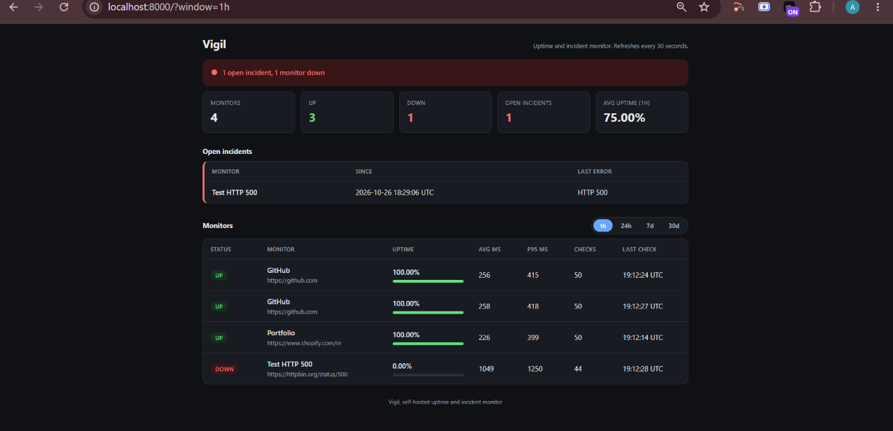
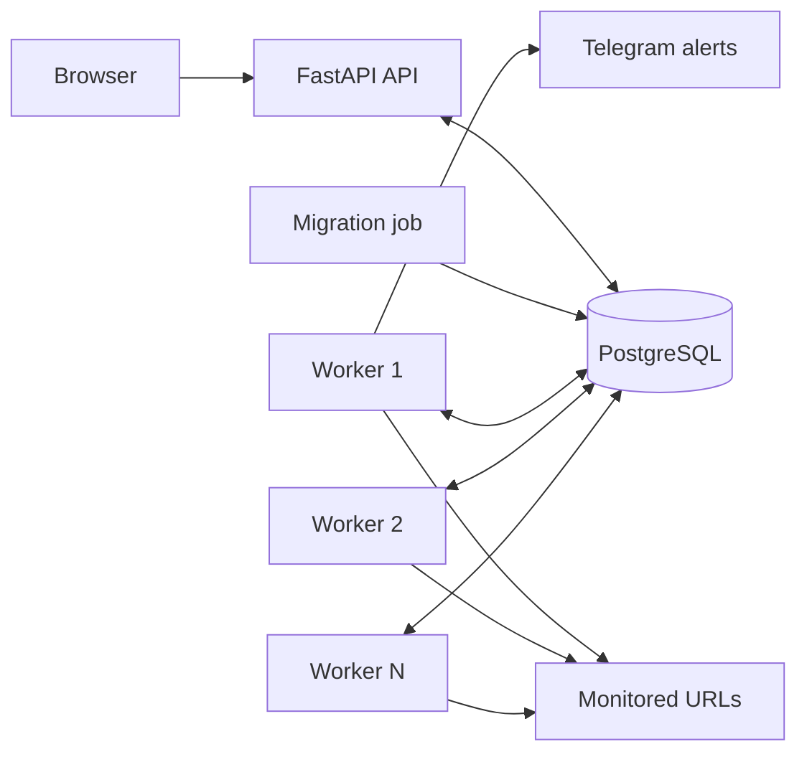
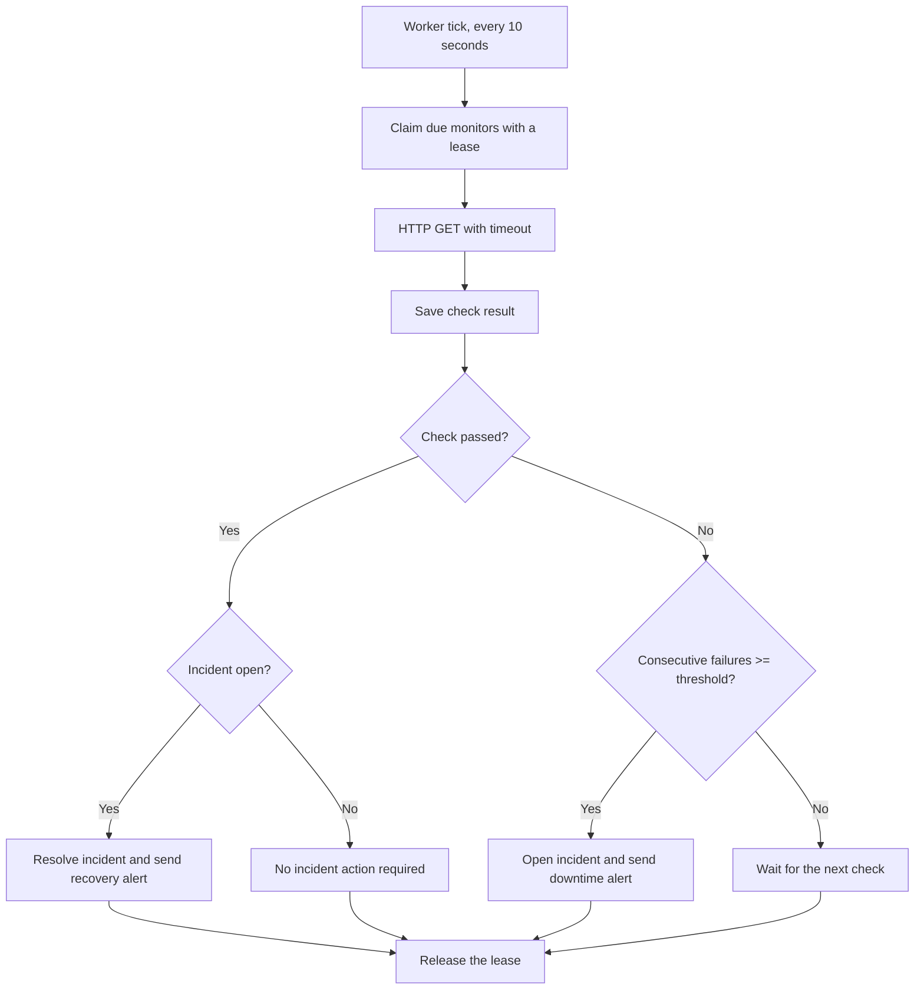

# Uptime Monitor

**A self-hosted uptime and incident monitoring system built with FastAPI and PostgreSQL.**

Vigil periodically checks websites and APIs, stores check results in PostgreSQL, calculates uptime and response-time statistics, detects incidents after consecutive failures, and sends Telegram notifications when a monitored target goes down or recovers.

The project includes a responsive dashboard, a REST API, versioned SQL migrations, and multiple workers that coordinate through database leases to avoid checking the same monitor concurrently.



**Demo recording:** [Watch the  demo (MP4)](docs/demo/vigil-demo.mp4)

The demo recording shows the application starting, a URL being monitored, the dashboard displaying monitor status, and checks and incidents appearing.

[](https://github.com/Aanushka001/vigil-uptime-monitor/actions/workflows/ci.yml)


---

## Contents

- [Features](#features)
- [Architecture](#architecture)
  - [One check cycle](#one-check-cycle)
  - [How workers avoid duplicate checks](#how-workers-avoid-duplicate-checks)
- [Prerequisites](#prerequisites)
- [Setup](#setup)
- [Database migrations](#database-migrations)
- [Running multiple workers](#running-multiple-workers)
- [Opening the dashboard](#opening-the-dashboard)
- [API checks](#api-checks)
- [Incident demo](#incident-demo)
- [Telegram alerts](#telegram-alerts)
- [Configuration](#configuration)
- [API reference](#api-reference)
- [Security notes](#security-notes)
- [Running tests](#running-tests)
- [Project structure](#project-structure)
- [Troubleshooting](#troubleshooting)
- [Limitations](#limitations)
- [License](#license)

---

## Features

- **Scheduled HTTP checks:** Configure each monitor's check interval, timeout, and failure threshold.
- **Incident detection:** Open an incident after a configured number of consecutive failures.
- **Automatic recovery:** Resolve an open incident when the monitored target becomes healthy again.
- **Telegram notifications:** Send alerts for downtime and recovery, with delivery status stored in the database.
- **Uptime and latency statistics:** Calculate uptime percentage, average response time, and p95 response time over supported time windows.
- **Versioned SQL migrations:** Apply schema changes in order while preserving existing monitors, checks, and incidents when upgrading from the supported older schema.
- **Multiple workers:** Coordinate monitor checks through PostgreSQL leases so workers do not intentionally claim the same monitor concurrently.
- **Responsive dashboard:** View overall status, summary tiles, uptime bars, monitor details, and open incidents.
- **REST API:** Manage monitors and inspect checks, incidents, and statistics through API endpoints.
- **API-key protection:** Protect write endpoints using the `X-API-Key` request header.
- **SSRF protection:** Validate user-supplied monitoring URLs and recheck resolved addresses before requests.
- **Interactive API documentation:** Explore the API at `/docs`.
- **PostgreSQL-backed storage:** Persist monitor definitions, check history, incidents, migrations, and alert records.
- **Automated testing:** Run the test suite against PostgreSQL; CI is configured to require the database where appropriate.

## Architecture

Vigil uses FastAPI for the HTTP API and dashboard, PostgreSQL for persistent storage and worker coordination, a migration service for schema updates, and one or more background workers for scheduled checks.



The API and workers do not call each other directly. They communicate through PostgreSQL. On startup, the migration job runs first; the API and workers start only after migrations succeed.

### One check cycle



The incident decision rules are implemented in the pure function `app/services/decision.py`. This function does not perform database or network operations and is tested independently.

### How workers avoid duplicate checks

Workers claim monitors through an atomic SQL statement and use PostgreSQL row locking with `FOR UPDATE SKIP LOCKED`.

The process works as follows:

1. A worker selects monitors that are active, due for checking, and not currently claimed. Rows locked by another worker are skipped rather than waited on.
2. The worker sets `claimed_until` to the current time plus a lease duration controlled by `WORKER_CLAIM_SECONDS`, which defaults to 120 seconds, and commits the claim.
3. The worker performs the HTTP checks and records the results.
4. The worker clears `claimed_until` so the monitor can become eligible for a later check when its interval has passed.

If a worker crashes, its lease eventually expires, allowing another worker to claim the monitor.

The database also uses the partial unique index `one_open_incident_per_monitor` to prevent more than one open incident for the same monitor.

---

## Prerequisites

- Docker Desktop or Docker Engine with Docker Compose v2.
- Git.
- Python 3.12, optional if running tests or Python tooling outside Docker.

Verify your Docker installation:

```bash
docker --version
docker compose version
```

Docker must be installed and running before you start the application through Docker Compose.

## Setup

### 1. Clone the repository

```bash
git clone https://github.com/Aanushka001/vigil-uptime-monitor.git
cd vigil-uptime-monitor
```

### 2. Create the environment file

Copy the example configuration:

```bash
cp .env.example .env
```

In Windows PowerShell, use:

```powershell
Copy-Item .env.example .env
```

Edit `.env` and configure your own `POSTGRES_PASSWORD` and `API_KEY`. Use a strong, private API key. The documented database-password guidance requires letters and digits only.

Do not commit `.env` or publish any secrets from it.

### 3. Start the application

Build and start the services:

```bash
docker compose up --build
```

To run the services in the background:

```bash
docker compose up -d --build
```

Compose starts PostgreSQL, runs the migration service, and then starts the API and background workers. The default configuration starts two worker replicas.

### 4. Verify the running services

```bash
docker compose ps
```

Check the application health endpoint:

```bash
curl http://localhost:8000/health
```

The health endpoint reports whether the API and database are responding successfully.

Open the dashboard at [http://localhost:8000](http://localhost:8000).

Open the interactive API documentation at [http://localhost:8000/docs](http://localhost:8000/docs).

---

## Database migrations

Vigil uses versioned SQL migrations to apply database schema changes in a controlled order.

Migration files are stored in `app/migrations/` and applied in filename order. Applied versions are recorded in the `schema_migrations` table.

| Migration | Purpose |
|---|---|
| `0001_baseline.sql` | Creates the original tables and indexes. |
| `0002_worker_claims.sql` | Adds `monitors.claimed_until` to support lease-based coordination between workers. |

Migrations run automatically through the `migrate` service when the application is started with Docker Compose.

### Run or inspect migrations manually

Run the migration service:

```bash
docker compose run --rm migrate
```

Inspect migration status:

```bash
docker compose run --rm migrate python -m app.migrate --status
```

Query the migration history:

```bash
docker compose exec db psql -U vigil -d vigil -c "select * from schema_migrations;"
```

### Upgrading an existing database

When the migration runner encounters a database created by a supported older version of Vigil, it detects an existing `monitors` table and records `0001_baseline` without executing the baseline migration again. It then applies newer migrations that have not yet been recorded.

This upgrade path is designed to preserve existing monitors, checks, and incidents.

### Adding a migration

To make a schema change:

1. Create the next numbered SQL file in `app/migrations/`, for example `0003_add_alert_cooldown.sql`.
2. Write the SQL, using idempotent statements where practical, such as `ADD COLUMN IF NOT EXISTS` or `CREATE INDEX IF NOT EXISTS`.
3. Apply the migration:

   ```bash
   docker compose run --rm migrate
   ```

Never edit a migration that has already been applied to a database. Create a new migration file instead.

Each migration runs in its own transaction, and a database lock prevents overlapping migration runs.

---

## Running multiple workers

Vigil supports multiple background workers that coordinate through PostgreSQL.

By default, `docker compose up` starts the number of workers configured by `WORKER_REPLICAS` in `.env`. The default is two.

To start four worker replicas for a run:

```bash
docker compose up -d --build --scale worker=4
```

Inspect the running services:

```bash
docker compose ps
```

View worker logs:

```bash
docker compose logs worker
```

Worker log lines include a `worker=` identifier, allowing you to distinguish the worker containers performing checks.

### Inspect check spacing

The following query calculates the minimum time between consecutive checks for each monitor:

```bash
docker compose exec db psql -U vigil -d vigil -c "select monitor_id, min(gap) as min_gap from (select monitor_id, checked_at - lag(checked_at) over (partition by monitor_id order by checked_at) as gap from checks) t group by monitor_id;"
```

Compare `min_gap` with the monitor's configured `interval_seconds`. This can help identify unexpected check spacing.

The lease mechanism is intended to prevent concurrent workers from claiming the same monitor. Actual check timing can also be affected by timeouts, scheduling, and processing delays.

---

## Opening the dashboard

Once the application is running, open:

- **Dashboard:** [http://localhost:8000](http://localhost:8000)
- **Interactive API documentation:** [http://localhost:8000/docs](http://localhost:8000/docs)

The dashboard provides:

- An overall monitoring status banner.
- Summary tiles with uptime and response-time information.
- A list of monitored websites and APIs.
- Monitor status indicators and uptime bars.
- An open-incident list.
- Recent monitoring information.

Use the `1h`, `24h`, `7d`, and `30d` controls to change the statistics window. The dashboard refreshes every 30 seconds and is designed to work on mobile screens as well as desktop browsers.

### Dashboard screenshot

The screenshot is stored at:

`docs/screenshots/dashboard.png`

GitHub renders this PNG inline when the README is viewed from the repository.

### Demo recording

The demo video is stored at:

`docs/demo/vigil-demo.mp4`

[Open the Vigil demo recording](docs/demo/vigil-demo.mp4).

A repository-relative MP4 link provides access to the video file, but GitHub does not guarantee inline video playback for a video stored as a normal repository file. For an embedded player, host the video using a GitHub-supported video attachment or another suitable video-hosting service and link to the hosted video.

---

## API checks

Vigil provides endpoints for creating monitors and reading their check results, statistics, and incidents.

Write endpoints require the API key in the `X-API-Key` header. Read endpoints documented below do not require this header.

### Load the API key

In Git Bash, you can load environment variables from `.env`:

```bash
set -a
source .env
set +a
```

In PowerShell:

```powershell
$key = ((Get-Content .env | Select-String '^API_KEY=').Line -split '=', 2)[1]
$h = @{ "X-API-Key" = $key }
```

Keep the key private and do not print it in a recording or commit it to Git.

### Check API and database health

```bash
curl http://localhost:8000/health
```

The health endpoint is useful for verifying that the API is responding and its database connection is healthy.

### Create a monitor

Use a website you own or a public service that permits automated requests. An interval of 60 seconds or more is a sensible starting point for a public target.

Git Bash:

```bash
curl -X POST http://localhost:8000/monitors \
  -H "X-API-Key: $API_KEY" \
  -H "Content-Type: application/json" \
  -d '{"name":"GitHub","url":"https://github.com","interval_seconds":60,"failure_threshold":3}'
```

PowerShell:

```powershell
$body = '{"name":"GitHub","url":"https://github.com","interval_seconds":60,"failure_threshold":3}'

Invoke-RestMethod `
  -Method Post `
  -Uri "http://localhost:8000/monitors" `
  -Headers $h `
  -ContentType "application/json" `
  -Body $body
```

The request creates a monitor named `GitHub` with a 60-second check interval and a failure threshold of three consecutive failures.

### List monitors and read results

List monitors:

```bash
curl http://localhost:8000/monitors
```

Retrieve recent checks for monitor ID `1`:

```bash
curl "http://localhost:8000/monitors/1/checks?limit=10"
```

Retrieve statistics for the last 24 hours:

```bash
curl "http://localhost:8000/monitors/1/stats?window=24h"
```

List incidents:

```bash
curl "http://localhost:8000/incidents?status=all"
```

The example monitor ID is `1`. Replace it with the actual ID returned by your API.

### Delete a monitor

Deleting a monitor requires the API key:

```bash
curl -X DELETE http://localhost:8000/monitors/1 \
  -H "X-API-Key: $API_KEY"
```

PowerShell:

```powershell
Invoke-RestMethod `
  -Method Delete `
  -Uri "http://localhost:8000/monitors/1" `
  -Headers $h
```

Deleting a monitor also deletes its associated history, according to the API behavior documented by this project. Confirm the monitor ID before running the command.

---

## Incident demo

Vigil includes a demo endpoint that can simulate a failing target. It is intended for local demonstrations and must not be enabled on an exposed production deployment.

The demo requires these settings in `.env`:

```dotenv
ALLOW_PRIVATE_TARGETS=true
ENABLE_DEMO_ENDPOINTS=true
```

These settings enable private-target monitoring and the demo endpoints. Restore both settings to `false` after the demonstration.

Restart the application after changing `.env`:

```bash
docker compose up -d --build
```

### 1. Create a demo monitor

The worker runs inside Docker, so the target URL uses the internal service name `api`:

```bash
curl -X POST http://localhost:8000/monitors \
  -H "X-API-Key: $API_KEY" \
  -H "Content-Type: application/json" \
  -d '{"name":"Demo flaky","url":"http://api:8000/demo/flaky","interval_seconds":10,"failure_threshold":2}'
```

The monitor checks every 10 seconds and opens an incident after two consecutive failures.

### 2. Simulate downtime

```bash
curl -X POST http://localhost:8000/demo/flaky/down \
  -H "X-API-Key: $API_KEY"
```

Wait approximately 30 seconds and refresh the dashboard. An incident should appear after the failure threshold is reached.

### 3. Restore the demo endpoint

```bash
curl -X POST http://localhost:8000/demo/flaky/up \
  -H "X-API-Key: $API_KEY"
```

Wait for the next successful check. The incident should resolve when the recovery is detected.

The exact time required depends on the worker schedule and the monitor's configured interval.

### 4. Inspect incidents

List open incidents:

```bash
curl "http://localhost:8000/incidents?status=open"
```

List resolved incidents:

```bash
curl "http://localhost:8000/incidents?status=resolved"
```

Inside Docker, workers reach the API through `http://api:8000`.

**Important:** Disable the demo flags after the demonstration and do not expose the demo endpoints on a public deployment.

---

## Telegram alerts

Vigil can send Telegram notifications when a monitor goes down and when an incident is resolved.

### Configure Telegram

1. Open Telegram and message `@BotFather`.
2. Send `/newbot` and follow the instructions to create a bot.
3. Copy the bot token provided by BotFather.
4. Send a message to your new bot.
5. Retrieve the updates using the Telegram Bot API endpoint:

   `https://api.telegram.org/bot<TOKEN>/getUpdates`

   Replace `<TOKEN>` with your bot token. Find the relevant chat's `id` in the response.

6. Add the following variables to `.env`:

   ```dotenv
   TELEGRAM_BOT_TOKEN=your_bot_token
   TELEGRAM_CHAT_ID=your_chat_id
   ```

7. Restart or recreate the application services so they load the updated configuration:

   ```bash
   docker compose up -d
   ```

Never commit your bot token or publish it in screenshots, logs, or recordings. If the token is exposed, revoke it through BotFather and replace it.

### Without Telegram configuration

Vigil continues to monitor targets even when Telegram credentials are absent. Incidents are still recorded, and alert records are stored with `delivered = false` when notifications cannot be delivered.

Inspect alert history:

```bash
docker compose exec db psql -U vigil -d vigil -c "select kind, delivered from alerts;"
```

The `delivered` field indicates whether an alert was delivered successfully.

---

## Configuration

Vigil reads its configuration from environment variables. In Docker Compose, these values are provided through `.env` and the Compose configuration.

| Variable | Default | Purpose |
|---|---|---|
| `POSTGRES_PASSWORD` | `vigil` | PostgreSQL database password. The documented setup requires letters and digits only. Change this for your deployment. |
| `DATABASE_URL` | Built by Compose | SQLAlchemy connection string used to connect to PostgreSQL. |
| `API_KEY` | `change-me-api-key` | Shared API key required in the `X-API-Key` header for write endpoints. Set a private value. |
| `TELEGRAM_BOT_TOKEN` | Empty | Telegram bot token used to send alerts. |
| `TELEGRAM_CHAT_ID` | Empty | Telegram chat that receives alerts. |
| `WORKER_REPLICAS` | `2` | Number of worker containers started by Compose. |
| `WORKER_TICK_SECONDS` | `10` | How frequently a worker looks for monitors that are due for checking. |
| `WORKER_THREADS` | `10` | Parallel checks per tick, per worker. |
| `WORKER_CLAIM_SECONDS` | `120` | Lease duration for a claimed monitor before the claim expires. |
| `ALLOW_PRIVATE_TARGETS` | `false` | Allows private and loopback targets. Intended for local demos only. |
| `ENABLE_DEMO_ENDPOINTS` | `false` | Enables the `/demo/flaky` endpoints. Intended for local demos only. |

The actual configuration in `.env` can differ from these defaults. Keep `.env` private and use `.env.example` to document configuration without exposing secrets.

---

## API reference

The following table summarizes the documented HTTP endpoints.

| Method | Path | Authentication | Description |
|---|---|---|---|
| `POST` | `/monitors` | API key | Create a monitor. |
| `GET` | `/monitors` | None | List monitors. |
| `GET` | `/monitors/{id}` | None | Retrieve one monitor. |
| `PATCH` | `/monitors/{id}` | API key | Edit or pause a monitor. |
| `DELETE` | `/monitors/{id}` | API key | Delete a monitor and its history. |
| `GET` | `/monitors/{id}/checks?limit=50` | None | Retrieve recent check results. |
| `GET` | `/monitors/{id}/stats?window=24h` | None | Retrieve uptime and latency statistics. Supported windows: `1h`, `24h`, `7d`, and `30d`. |
| `GET` | `/incidents?status=open` | None | List incidents. Supported statuses: `open`, `resolved`, and `all`. |
| `GET` | `/health` | None | Check API and database liveness. |
| `GET` | `/` | None | Serve the HTML dashboard. |

The API also provides demo endpoints when `ENABLE_DEMO_ENDPOINTS=true`. These are intended for local demonstrations.

For request schemas, response models, and interactive exploration, open [http://localhost:8000/docs](http://localhost:8000/docs) while the application is running.

---

## Security notes

Vigil makes HTTP requests to URLs supplied through monitor configuration. It includes protections against server-side request forgery (SSRF).

The documented protections include:

- **Allowed protocols:** Only `http` and `https` URLs are accepted.
- **Address validation:** Hostnames are resolved and rejected when they point to private, loopback, link-local, reserved, or multicast addresses.
- **Worker-side revalidation:** The worker rechecks resolved addresses before each request.
- **Redirect handling:** Redirects are not followed, preventing a redirect from reaching an unvalidated destination.
- **Response handling:** Response bodies are not downloaded or stored.
- **Logging:** Request URLs are kept out of logs.
- **API key comparison:** API key comparison uses a constant-time comparison.
- **Environment-based secrets:** Secrets are configured through environment variables. `.env` is Git-ignored.

For the documented checker behavior, HTTP status codes below `400` count as successful checks. A non-success status can contribute to incident detection when the configured consecutive-failure threshold is reached.

### Deployment precautions

- Set a strong, unique `API_KEY`.
- Set a secure database password.
- Never commit `.env` or share API keys and Telegram credentials.
- Keep `ALLOW_PRIVATE_TARGETS=false` and `ENABLE_DEMO_ENDPOINTS=false` for normal deployments.
- Do not expose development or demo endpoints unnecessarily.
- Use only monitoring targets that you are authorized to check.

SSRF protections are an important safeguard, but they do not replace deployment-level network controls, access restrictions, and secret management.

---

## Running tests

Vigil's tests require PostgreSQL. The project uses `requirements-dev.txt` for development and test dependencies.

### 1. Start a test database

The following command starts a separate PostgreSQL container for testing:

```bash
docker run -d --name vigil-test-db -p 5432:5432 \
  -e POSTGRES_USER=vigil \
  -e POSTGRES_PASSWORD=vigil \
  -e POSTGRES_DB=vigil_test \
  postgres:16-alpine
```

Make sure Docker is installed and running before executing this command.

If a container named `vigil-test-db` already exists, inspect it before attempting to create another one.

### 2. Create a Python virtual environment

```bash
python -m venv .venv
```

Activate the environment in Git Bash:

```bash
source .venv/bin/activate
```

In Windows PowerShell:

```powershell
.\.venv\Scripts\Activate.ps1
```

### 3. Install development dependencies

```bash
pip install -r requirements-dev.txt
```

### 4. Run the tests

```bash
pytest -q
```

The tests should use the test database rather than a database containing data you care about.

To use another test database, configure `TEST_DATABASE_URL` as supported by the project.

The test fixtures drop and recreate Vigil's tables. **Never point the test suite at a database containing important data.**

In CI, `REQUIRE_DB=1` makes missing-database skips fail instead of silently allowing the test suite to pass with database-dependent tests skipped.

If the test output contains `s`, those tests were skipped. Check that the test database is reachable and that the test configuration is correct before treating the test run as successful.

---

## Project structure

The main project directories and files are organized as follows:

```text
vigil-uptime-monitor/
├── .github/
│   └── workflows/
│       └── ci.yml
├── app/
│   ├── main.py                 FastAPI application, health endpoint, and dashboard
│   ├── config.py               Configuration from environment variables
│   ├── db.py                   Database engine and session setup
│   ├── models.py               SQLAlchemy ORM models
│   ├── schemas.py              Pydantic request and response models
│   ├── security.py             API key dependency
│   ├── migrate.py              Migration runner
│   ├── migrations/             Versioned SQL migrations
│   ├── worker.py               Polling worker and lease-based claims
│   ├── routers/                Monitor, incident, statistics, and demo routes
│   ├── services/
│   │   ├── decision.py         Incident decision rules
│   │   ├── checker.py          HTTP checking logic
│   │   ├── incidents.py        Incident handling
│   │   ├── alerts.py            Alert handling
│   │   ├── stats.py             Uptime and latency statistics
│   │   └── url_safety.py        URL validation and SSRF protections
│   └── templates/
│       └── dashboard.html      Dashboard template
├── sql/
│   └── schema.sql              Original baseline schema
├── docs/
│   ├── demo/
│   │   └── vigil-demo.mp4      Demo recording
│   ├── screenshots/
│   │   └── dashboard.png       Dashboard screenshot
│   ├── Terminal.png            Terminal screenshot
│   └── uptime_monitor_architecture.png
├── tests/                      Automated tests
├── Dockerfile                  Application container image
├── docker-compose.yml          Database, migration, API, and worker services
├── requirements.txt            Application dependencies
├── requirements-dev.txt        Development and test dependencies
├── pytest.ini                  Pytest configuration
├── .env.example                Example environment configuration
├── .gitignore                  Files excluded from Git
├── LICENSE                     MIT license
└── README.md                   Project documentation
```

The exact contents of the `app/`, `sql/`, and `tests/` directories can change as the project evolves. Versioned migrations are stored in `app/migrations/`; `sql/schema.sql` documents the original baseline schema.

---

## Troubleshooting

### `Cannot connect to the Docker daemon`

Docker Desktop may not be running. Start Docker Desktop and wait until the engine is ready.

Then check:

```bash
docker --version
docker compose version
docker compose ps
```

### `docker: command not found` or `docker` is not recognized

Docker may not be installed, or the terminal may not have the updated `PATH`.

After installing Docker Desktop, reopen the terminal. In Windows PowerShell, you can refresh the current session's `PATH` with:

```powershell
$env:Path = [Environment]::GetEnvironmentVariable("Path", "Machine") + ";" + [Environment]::GetEnvironmentVariable("Path", "User")
```

Then run:

```powershell
docker --version
docker compose version
```

### Port `8000` is already in use

Another application may already be listening on port `8000`.

You can stop that application or change the host-side port mapping in `docker-compose.yml` from:

```yaml
ports:
  - "8000:8000"
```

to:

```yaml
ports:
  - "8001:8000"
```

Then access Vigil at [http://localhost:8001](http://localhost:8001).

### Database password errors after editing `.env`

PostgreSQL keeps the password initialized when its data directory is first created. Changing `POSTGRES_PASSWORD` in `.env` does not automatically change the existing database user's password.

For a disposable local environment, you can recreate the database volume:

```bash
docker compose down -v
docker compose up --build
```

**Warning:** `docker compose down -v` deletes the Compose-managed database volume and its data. Do not run it if you need to preserve monitors, checks, incidents, or other stored information.

### API or workers do not start

The migration job must succeed before the API and workers start.

Inspect the migration logs:

```bash
docker compose logs migrate
```

Inspect all service logs:

```bash
docker compose logs
```

Check the current service state:

```bash
docker compose ps
```

Resolve any migration or database connection errors before restarting the application.

### `column "claimed_until" does not exist`

The database may not have the worker-claims migration applied.

Run:

```bash
docker compose run --rm migrate
```

Then inspect the migration history:

```bash
docker compose exec db psql -U vigil -d vigil -c "select * from schema_migrations;"
```

### `Host could not be resolved` when creating a monitor

Check that the URL contains a valid hostname and that the domain resolves correctly. Open the URL in a browser to verify that the hostname is correct.

Also check whether the URL is being rejected by Vigil's URL validation or SSRF protections.

### `403` or `404` in worker logs

The target might block automated requests, the requested path might not exist, or the target may respond differently to automated traffic.

Check the URL and choose an authorized target that permits monitoring. A response from a website does not necessarily mean that the exact path is available.

### A monitor is not checked after a worker crash

A crashed worker can leave a monitor claimed until its lease expires. The default `WORKER_CLAIM_SECONDS` is 120 seconds.

Wait for the lease to expire, then check the worker logs and monitor history.

For a local development environment only, you can clear claims manually:

```bash
docker compose exec db psql -U vigil -d vigil -c "update monitors set claimed_until = null;"
```

This clears claims for all monitors. Do not run it casually while active workers are operating, because it can allow monitors to be claimed again before their previous processing has finished.

### Telegram alerts show `delivered = f`

Check that `TELEGRAM_BOT_TOKEN` and `TELEGRAM_CHAT_ID` are correct in `.env`.

Make sure you have sent a message to the bot and configured the correct chat ID. Restart the application after changing the configuration, then inspect alert records:

```bash
docker compose exec db psql -U vigil -d vigil -c "select kind, delivered from alerts;"
```

### Stop the application

To stop services while retaining the database volume:

```bash
docker compose down
```

To stop services and delete the Compose-managed volumes:

```bash
docker compose down -v
```

The second command deletes persisted database data. Use it only when you intentionally want to reset the local environment.

---

## Limitations

- **Single monitoring location:** Checks run from one deployment location, so Vigil cannot independently determine whether an outage is regional or global.
- **Database-based coordination:** Workers coordinate through PostgreSQL leases. This approach suits a small deployment, while a large deployment may benefit from a dedicated queue or scheduling system.
- **Shared API key:** Authentication uses one shared API key rather than individual user accounts or role-based access control.
- **HTTP(S) checks only:** The documented implementation monitors HTTP and HTTPS endpoints.
- **Telegram alerts only:** Telegram is the implemented notification integration described by this project.
- **Background-worker hosting requirements:** Free hosting tiers often do not keep background workers running continuously. The project is documented and demonstrated locally using Docker Compose.

These limitations describe the current documented scope of Vigil and do not imply that additional integrations or deployment options are already implemented.

---

## License

Vigil is released under the MIT License. See [LICENSE](LICENSE) for the complete license text.
