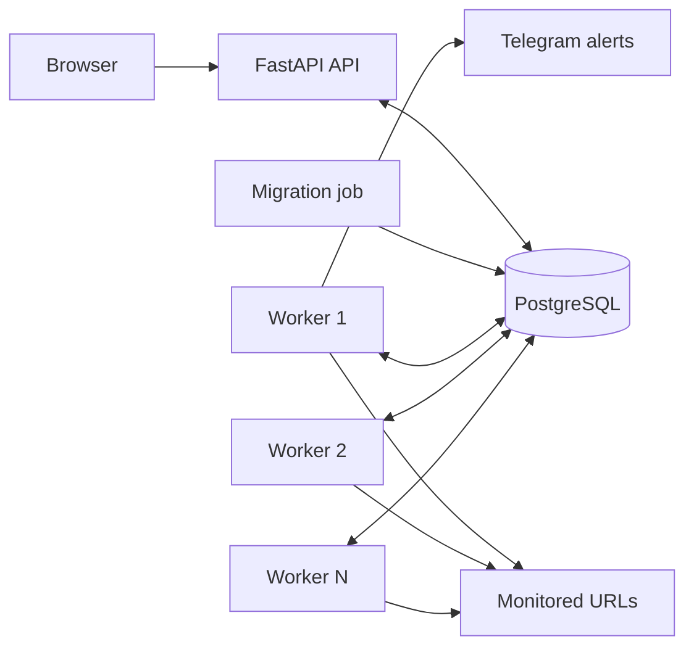
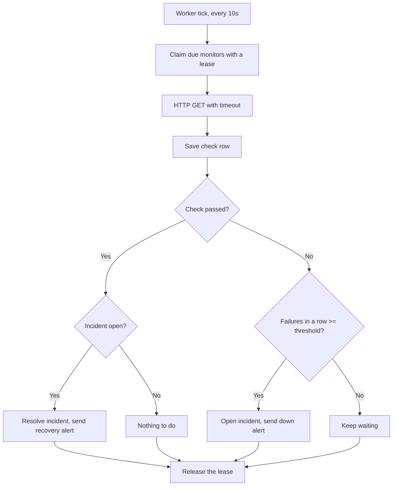

# Vigil

**A self-hosted uptime and incident monitor.** Vigil checks websites and APIs on a schedule, stores every result in PostgreSQL, opens an incident after repeated failures, and sends Telegram alerts when a target goes down and when it recovers.

[](https://github.com/Aanushka001/vigil-uptime-monitor/actions/workflows/ci.yml)


**Demo recording:** [docs/demo/vigil-demo.mp4](docs/demo/vigil-demo.mp4) shows the stack starting, a URL being monitored, the dashboard opening, and checks and incidents appearing.

## Contents

- [Features](#features)
- [Architecture](#architecture)
- [Prerequisites](#prerequisites)
- [Setup](#setup)
- [Database migrations](#database-migrations)
- [Running multiple workers](#running-multiple-workers)
- [Opening the dashboard](#opening-the-dashboard)
- [API checks](#api-checks)
- [Incident demo](#incident-demo)
- [Telegram alerts](#telegram-alerts)
- [Configuration](#configuration)
- [API reference](#api-reference)
- [Security notes](#security-notes)
- [Running tests](#running-tests)
- [Project structure](#project-structure)
- [Troubleshooting](#troubleshooting)
- [Limitations](#limitations)
- [License](#license)

## Features

- Scheduled HTTP checks with per-monitor interval, timeout and failure threshold
- Incident detection: an incident opens only after N consecutive failures
- Automatic recovery: the incident closes when the target is healthy again
- Telegram alerts for down and recovered events, with delivery status stored
- Uptime percentage, average latency and p95 latency per time window, computed in SQL
- Versioned SQL migrations that preserve existing monitors, checks and incidents
- Multiple workers that never check the same monitor at the same time
- Responsive dashboard with a status overview, uptime bars and incident list
- REST API with interactive docs at `/docs`, write endpoints protected by an API key
- SSRF protection for user-supplied URLs
- Test suite that runs against a real PostgreSQL database in CI

## Architecture



The API and the workers never call each other. They communicate only through the database. On startup the migration job runs first, and the API and workers start only after it succeeds.

### One check cycle



The incident rules live in one pure function, `app/services/decision.py`, which has no database or network access and is unit-tested branch by branch.

### How workers avoid duplicate checks

Each worker claims monitors with one atomic SQL statement:

1. It selects monitors that are active, due, and not currently claimed, using `FOR UPDATE SKIP LOCKED`, so rows locked by another worker are skipped instead of waited on.
2. It sets `claimed_until` to now plus a short lease (`WORKER_CLAIM_SECONDS`, default 120) and commits.
3. It runs the checks and records the results.
4. It clears `claimed_until` so the monitor is eligible again when its interval has passed.

If a worker crashes, its lease expires and another worker picks the monitor up. As a second safety net, the partial unique index `one_open_incident_per_monitor` makes a duplicate open incident impossible at the database level.

## Prerequisites

- Docker Desktop (or Docker Engine) with Docker Compose v2
- Git
- Optional, for running tests outside Docker: Python 3.12

Check that Docker is running:

```bash
docker --version
docker compose version
```

## Setup

```bash
git clone https://github.com/Aanushka001/vigil-uptime-monitor.git
cd vigil-uptime-monitor
cp .env.example .env
```

Edit `.env` and set your own `POSTGRES_PASSWORD` (letters and digits only) and `API_KEY`. Then start everything:

```bash
docker compose up --build
```

Compose starts the database, runs the migrations, then starts the API and two workers. To run in the background, add `-d`.

Windows PowerShell equivalent for the copy step: `Copy-Item .env.example .env`.

## Database migrations

Schema changes are plain SQL files in `app/migrations/`, applied in filename order. Applied versions are recorded in the `schema_migrations` table.

| File | Purpose |
|---|---|
| `0001_baseline.sql` | Original tables and indexes |
| `0002_worker_claims.sql` | Adds `monitors.claimed_until` for multi-worker leases |

Migrations run automatically through the `migrate` service every time you run `docker compose up`. To run or inspect them by hand:

```bash
docker compose run --rm migrate
docker compose run --rm migrate python -m app.migrate --status
docker compose exec db psql -U vigil -d vigil -c "select * from schema_migrations;"
```

If you already have a database created by an older version of Vigil, the runner detects the existing `monitors` table, records `0001_baseline` without re-running it, and applies only the newer migrations. Your monitors, checks and incidents are kept.

To add a change:

1. Create the next numbered file, for example `app/migrations/0003_add_alert_cooldown.sql`.
2. Write idempotent SQL where possible (`ADD COLUMN IF NOT EXISTS`, `CREATE INDEX IF NOT EXISTS`).
3. Run `docker compose run --rm migrate`.

Never edit a migration that has already been applied. Add a new file instead. Each file runs in its own transaction, and a lock prevents two migration runs from overlapping.

## Running multiple workers

`docker compose up` starts the number of workers set by `WORKER_REPLICAS` in `.env` (default 2). To pick a number for one run:

```bash
docker compose up -d --build --scale worker=4
```

Verify them:

```bash
docker compose ps
docker compose logs worker
```

Each log line starts with `worker=<container id>`, so you can see checks spread across workers. To confirm that no monitor was checked twice within its interval, run this and check that `min_gap` is at least the monitor's `interval_seconds`:

```bash
docker compose exec db psql -U vigil -d vigil -c "select monitor_id, min(gap) as min_gap from (select monitor_id, checked_at - lag(checked_at) over (partition by monitor_id order by checked_at) as gap from checks) t group by monitor_id;"
```

## Opening the dashboard

- Dashboard: http://localhost:8000
- Interactive API docs: http://localhost:8000/docs

The dashboard shows an overall status banner, summary tiles, open incidents, and a table of monitors with uptime bars. Use the `1h`, `24h`, `7d` and `30d` switch to change the window. It refreshes every 30 seconds and works on phones.

## API checks

Load your key. In Git Bash:

```bash
set -a; source .env; set +a
```

In PowerShell:

```powershell
$key = ((Get-Content .env | Select-String '^API_KEY=').Line -split '=',2)[1]
$h = @{ "X-API-Key" = $key }
```

Check the API and database:

```bash
curl http://localhost:8000/health
```

Create a monitor (use a site you own or a large public service, with an interval of 60 seconds or more):

```bash
curl -X POST http://localhost:8000/monitors \
  -H "X-API-Key: $API_KEY" -H "Content-Type: application/json" \
  -d '{"name":"GitHub","url":"https://github.com","interval_seconds":60,"failure_threshold":3}'
```

```powershell
$body = '{"name":"GitHub","url":"https://github.com","interval_seconds":60,"failure_threshold":3}'
Invoke-RestMethod -Method Post -Uri http://localhost:8000/monitors -Headers $h -ContentType "application/json" -Body $body
```

Read results:

```bash
curl http://localhost:8000/monitors
curl "http://localhost:8000/monitors/1/checks?limit=10"
curl "http://localhost:8000/monitors/1/stats?window=24h"
curl "http://localhost:8000/incidents?status=all"
```

Delete a monitor:

```bash
curl -X DELETE http://localhost:8000/monitors/1 -H "X-API-Key: $API_KEY"
```

## Incident demo

The demo endpoint needs `ALLOW_PRIVATE_TARGETS=true` and `ENABLE_DEMO_ENDPOINTS=true` in `.env`. Use it for local demos only.

```bash
curl -X POST http://localhost:8000/monitors \
  -H "X-API-Key: $API_KEY" -H "Content-Type: application/json" \
  -d '{"name":"Demo flaky","url":"http://api:8000/demo/flaky","interval_seconds":10,"failure_threshold":2}'

curl -X POST http://localhost:8000/demo/flaky/down -H "X-API-Key: $API_KEY"
```

Wait about 30 seconds and refresh the dashboard: an incident opens. Then:

```bash
curl -X POST http://localhost:8000/demo/flaky/up -H "X-API-Key: $API_KEY"
```

Wait about 15 seconds: the incident resolves. Inside Docker the workers reach the API at `http://api:8000`.

## Telegram alerts

1. In Telegram, message `@BotFather`, send `/newbot`, and copy the bot token.
2. Send any message to your new bot, then open `https://api.telegram.org/bot<TOKEN>/getUpdates` and copy the `chat` `id`.
3. Put both values in `.env` as `TELEGRAM_BOT_TOKEN` and `TELEGRAM_CHAT_ID`, then run `docker compose up -d`.

Without these values Vigil still works: incidents are recorded and alerts are stored with `delivered = false`. Check alert history with:

```bash
docker compose exec db psql -U vigil -d vigil -c "select kind, delivered from alerts;"
```

Never commit the bot token. If it leaks, send `/revoke` to BotFather.

## Configuration

| Variable | Default | Purpose |
|---|---|---|
| `POSTGRES_PASSWORD` | `vigil` | Database password. Letters and digits only |
| `DATABASE_URL` | built by Compose | SQLAlchemy connection string |
| `API_KEY` | `change-me-api-key` | Required in the `X-API-Key` header for write endpoints |
| `TELEGRAM_BOT_TOKEN` | empty | Bot token for alerts |
| `TELEGRAM_CHAT_ID` | empty | Chat that receives alerts |
| `WORKER_REPLICAS` | `2` | Number of worker containers started by Compose |
| `WORKER_TICK_SECONDS` | `10` | How often a worker looks for due monitors |
| `WORKER_THREADS` | `10` | Parallel checks per tick, per worker |
| `WORKER_CLAIM_SECONDS` | `120` | How long a worker holds a monitor before the lease expires |
| `ALLOW_PRIVATE_TARGETS` | `false` | Allow private and loopback targets. Local demos only |
| `ENABLE_DEMO_ENDPOINTS` | `false` | Expose `/demo/flaky`. Local demos only |

## API reference

| Method | Path | Auth | Description |
|---|---|---|---|
| `POST` | `/monitors` | API key | Create a monitor |
| `GET` | `/monitors` | none | List monitors |
| `GET` | `/monitors/{id}` | none | Get one monitor |
| `PATCH` | `/monitors/{id}` | API key | Edit or pause a monitor |
| `DELETE` | `/monitors/{id}` | API key | Delete a monitor and its history |
| `GET` | `/monitors/{id}/checks?limit=50` | none | Recent check results |
| `GET` | `/monitors/{id}/stats?window=24h` | none | Uptime and latency (`1h`, `24h`, `7d`, `30d`) |
| `GET` | `/incidents?status=open` | none | Incidents (`open`, `resolved`, `all`) |
| `GET` | `/health` | none | API and database liveness |
| `GET` | `/` | none | HTML dashboard |

## Security notes

Vigil requests URLs supplied by users, so it guards against server-side request forgery (SSRF):

- Only `http` and `https` URLs are accepted.
- Hostnames are resolved and rejected if they point to private, loopback, link-local, reserved or multicast addresses. The worker re-checks before every request.
- Redirects are not followed, so a redirect cannot reach an unvalidated address. Status codes below 400 count as up.
- Response bodies are never downloaded or stored.
- Request URLs are kept out of logs, and the API key comparison is constant-time.
- Secrets come from environment variables. `.env` is git-ignored.

## Running tests

Tests need a PostgreSQL database. Start a throwaway one:

```bash
docker run -d --name vigil-test-db -p 5432:5432 \
  -e POSTGRES_USER=vigil -e POSTGRES_PASSWORD=vigil -e POSTGRES_DB=vigil_test \
  postgres:16-alpine

python -m venv .venv && source .venv/bin/activate
pip install -r requirements-dev.txt
pytest -q
```

On Windows PowerShell, activate with `.venv\Scripts\Activate.ps1`. To use another database, set `TEST_DATABASE_URL`. The fixtures drop and recreate Vigil's tables, so never point it at data you care about. In CI, `REQUIRE_DB=1` makes missing-database skips fail instead.

## Project structure

```
vigil-uptime-monitor/
├── app/
│   ├── main.py              FastAPI app, /health and dashboard
│   ├── config.py            Settings from environment variables
│   ├── db.py, models.py     SQLAlchemy engine, session and ORM models
│   ├── schemas.py           Pydantic request and response models
│   ├── security.py          API key dependency
│   ├── migrate.py           Migration runner (python -m app.migrate)
│   ├── migrations/          Versioned SQL migrations
│   ├── worker.py            Polling worker with lease-based claims
│   ├── routers/             monitors, incidents, stats, demo
│   ├── services/            decision, checker, incidents, alerts, stats, url_safety
│   └── templates/dashboard.html
├── sql/schema.sql           Original baseline schema
├── docs/demo/vigil-demo.mp4 Demo recording
├── tests/
├── Dockerfile, docker-compose.yml
└── .github/workflows/ci.yml
```

## Troubleshooting

- **`Cannot connect to the Docker daemon`**: Docker Desktop is not running. Start it and wait until it reports running.
- **`docker: command not found` in Git Bash**: reopen the terminal after installing Docker Desktop. In PowerShell, run `$env:Path = [Environment]::GetEnvironmentVariable("Path","Machine") + ";" + [Environment]::GetEnvironmentVariable("Path","User")`.
- **Port 8000 already in use**: stop the other program, or change `"8000:8000"` in `docker-compose.yml` to `"8001:8000"` and use port 8001.
- **Database password errors after editing `.env`**: the database keeps the password from its first start. Run `docker compose down -v` (this deletes data), then `docker compose up --build`.
- **API or workers do not start**: the migration job must succeed first. Read its output with `docker compose logs migrate`.
- **`column "claimed_until" does not exist`**: migrations have not run. Run `docker compose run --rm migrate`.
- **`Host could not be resolved` when creating a monitor**: the URL is not a real domain. Open it in a browser first.
- **403 or 404 in worker logs**: the target blocks automated requests or the path is wrong. Choose another target.
- **A monitor is never checked after a worker crash**: wait for `WORKER_CLAIM_SECONDS` to pass, or clear the lease with `docker compose exec db psql -U vigil -d vigil -c "update monitors set claimed_until = null;"`.
- **Telegram alerts show `delivered = f`**: check `TELEGRAM_BOT_TOKEN` and `TELEGRAM_CHAT_ID`, and make sure you sent your bot a message first.
- **Stop everything**: `docker compose down` keeps your data, `docker compose down -v` deletes it.

## Limitations

- Checks run from a single location, so Vigil cannot tell a regional outage from a global one.
- Workers coordinate through database leases, which suits a small deployment. A large deployment would use a dedicated queue.
- Authentication is a single shared API key, not user accounts.
- Only HTTP(S) checks and Telegram alerts are implemented.
- Free hosting tiers generally do not run a background worker, so this project is documented and demonstrated locally with Docker Compose.

## License

MIT. See [LICENSE](LICENSE).