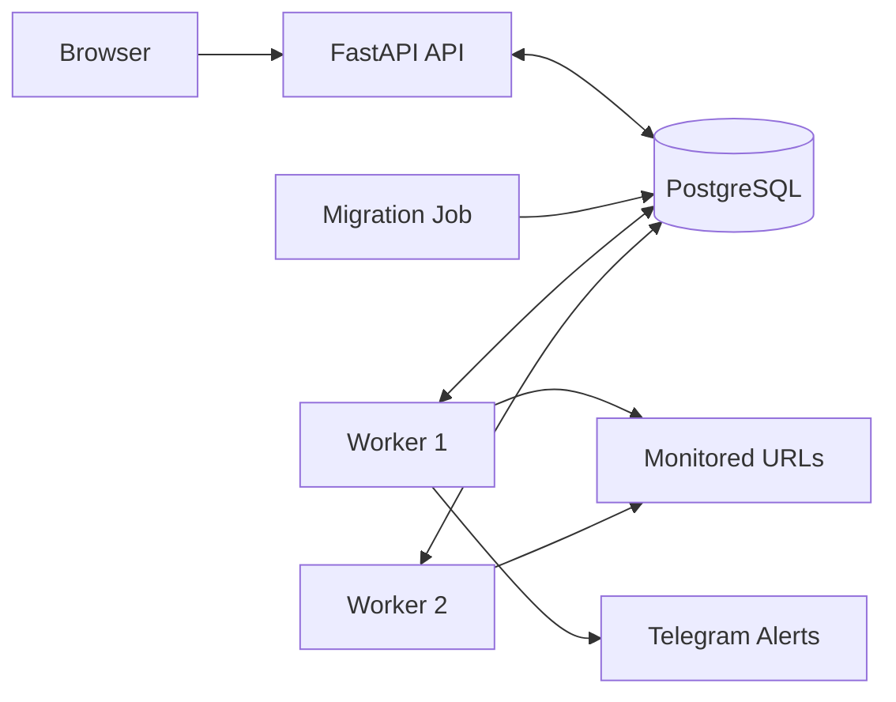

# UptimeMonitor

**A self-hosted uptime and incident monitoring system built with FastAPI and PostgreSQL.**

UptimeMonitor checks websites and APIs, tracks uptime and response times, detects incidents, and sends Telegram alerts when a service goes down or recovers.

[](https://github.com/Aanushka001/uptimemonitor/actions/workflows/ci.yml)


## Features

- **Website Monitoring:** Scheduled HTTP and HTTPS checks.
- **Incident Detection:** Detects consecutive failures and records incidents.
- **Automatic Recovery:** Resolves incidents when services recover.
- **Uptime Statistics:** Tracks uptime, average response time, and p95 response time.
- **Telegram Alerts:** Sends downtime and recovery notifications.
- **Dashboard:** Displays monitor status, statistics, and incidents.
- **REST API:** Create, update, delete, and inspect monitors.
- **Worker Coordination:** Uses PostgreSQL leases to coordinate multiple workers.
- **Database Migrations:** Applies versioned SQL migrations.
- **Security:** API-key authentication and SSRF protections.

## Dashboard and Demo


**Demo recording:** [Watch the UptimeMonitor demo (MP4)](docs/demo/uptimemonitor-demo.mp4)

The dashboard displays monitored websites, status indicators, uptime statistics, response times, and incidents.

## Architecture

UptimeMonitor uses FastAPI for the API and dashboard, PostgreSQL for persistent storage and worker coordination, and background workers for scheduled checks.



Workers claim due monitors through PostgreSQL leases to reduce duplicate concurrent checks. Incidents are opened after the configured failure threshold and resolved after recovery.

## Getting Started

### Prerequisites

- Docker Desktop or Docker Engine with Docker Compose v2
- Git
- Python 3.12 (optional for local testing)

### 1. Clone the Repository

```bash
git clone https://github.com/Aanushka001/uptimemonitor.git
cd uptimemonitor
```

### 2. Configure Environment Variables

```bash
cp .env.example .env
```

On Windows PowerShell:

```powershell
Copy-Item .env.example .env
```

Update `POSTGRES_PASSWORD` and `API_KEY` in `.env`. Keep secrets private and never commit this file.

### 3. Start the Application

```bash
docker compose up --build
```

To run it in the background:

```bash
docker compose up -d --build
```

### 4. Open the Application

- **Dashboard:** [http://localhost:8000](http://localhost:8000)
- **API Documentation:** [http://localhost:8000/docs](http://localhost:8000/docs)
- **Health Check:** [http://localhost:8000/health](http://localhost:8000/health)

Check running services:

```bash
docker compose ps
```

## Configuration

UptimeMonitor reads configuration from environment variables and the `.env` file.

| Variable | Purpose |
|---|---|
| `POSTGRES_PASSWORD` | PostgreSQL password |
| `DATABASE_URL` | Database connection string |
| `API_KEY` | Authentication for write endpoints |
| `TELEGRAM_BOT_TOKEN` | Telegram bot token |
| `TELEGRAM_CHAT_ID` | Telegram destination chat |
| `WORKER_REPLICAS` | Number of worker containers |
| `WORKER_TICK_SECONDS` | Worker scheduling interval |
| `WORKER_THREADS` | Parallel checks per worker |
| `WORKER_CLAIM_SECONDS` | Monitor lease duration |
| `ALLOW_PRIVATE_TARGETS` | Allows private targets for local demos |
| `ENABLE_DEMO_ENDPOINTS` | Enables demo endpoints |

Use `.env.example` to review the available settings. Keep demo-only options disabled for normal deployments.

## API Reference

Write endpoints require the `X-API-Key` header. Read endpoints listed below do not require it.

| Method | Endpoint | Description |
|---|---|---|
| `POST` | `/monitors` | Create a monitor |
| `GET` | `/monitors` | List monitors |
| `GET` | `/monitors/{id}` | Get monitor details |
| `PATCH` | `/monitors/{id}` | Update or pause a monitor |
| `DELETE` | `/monitors/{id}` | Delete a monitor and its history |
| `GET` | `/monitors/{id}/checks` | View check history |
| `GET` | `/monitors/{id}/stats?window=24h` | View uptime and latency statistics |
| `GET` | `/incidents?status=open` | List incidents |
| `GET` | `/health` | Check application health |

Explore request schemas and responses through the [interactive API documentation](http://localhost:8000/docs).

### Example: Create a Monitor

```bash
curl -X POST http://localhost:8000/monitors \
  -H "X-API-Key: $API_KEY" \
  -H "Content-Type: application/json" \
  -d '{"name":"GitHub","url":"https://github.com","interval_seconds":60,"failure_threshold":3}'
```

Use monitoring targets you own or are authorized to check.

## Telegram Alerts

1. Create a bot using Telegram's `@BotFather`.
2. Obtain the bot token and chat ID.
3. Add them to `.env`:

```dotenv
TELEGRAM_BOT_TOKEN=your_bot_token
TELEGRAM_CHAT_ID=your_chat_id
```

4. Restart the application:

```bash
docker compose up -d
```

Never publish your bot token or API key. Monitoring continues even when Telegram is not configured, but notifications cannot be delivered.

## Security

- Accepts HTTP and HTTPS monitoring URLs.
- Validates resolved addresses to help prevent SSRF.
- Rechecks addresses before worker requests.
- Does not follow redirects.
- Protects write endpoints with an API key.
- Keeps secrets in environment variables.

For normal deployments, keep `ALLOW_PRIVATE_TARGETS=false` and `ENABLE_DEMO_ENDPOINTS=false`. These protections do not replace network restrictions and secure deployment practices.

## Running Tests

Tests require PostgreSQL and the development dependencies.

```bash
python -m venv .venv
```

Activate the environment, then install dependencies:

```bash
pip install -r requirements-dev.txt
```

Run the tests:

```bash
pytest -q
```

Use a dedicated test database. The test fixtures may drop and recreate project tables, so never point the test suite at a database containing important data.

## Project Structure

```text
uptimemonitor/
├── .github/workflows/    # CI configuration
├── app/
│   ├── main.py           # FastAPI application and dashboard
│   ├── config.py         # Environment configuration
│   ├── db.py             # Database setup
│   ├── models.py         # Database models
│   ├── schemas.py        # API schemas
│   ├── security.py       # API-key protection
│   ├── migrate.py        # Migration runner
│   ├── migrations/       # Versioned SQL migrations
│   ├── routers/          # API routes
│   ├── services/         # Checks, incidents, alerts and statistics
│   ├── worker.py         # Background worker
│   └── templates/        # Dashboard template
├── docs/
│   ├── demo/             # MP4 demo recording
│   ├── screenshots/      # Dashboard screenshots
│   ├── Terminal.png
│   └── uptime_monitor_architecture.png
├── tests/                # Automated tests
├── Dockerfile
├── docker-compose.yml
├── requirements.txt
├── requirements-dev.txt
├── .env.example
├── LICENSE
└── README.md
```

## Troubleshooting

### Docker Is Not Running

Start Docker Desktop, then run:

```bash
docker compose ps
```

### Port 8000 Is Already in Use

Change the host-side port mapping in `docker-compose.yml` from `8000:8000` to `8001:8000`, then access the dashboard at [http://localhost:8001](http://localhost:8001).

### Database or Migration Errors

Inspect service logs:

```bash
docker compose logs migrate
docker compose logs
```

### Stop the Application

```bash
docker compose down
```

This retains the database volume. Avoid `docker compose down -v` unless you intentionally want to delete persisted database data.

## Limitations

- Monitoring checks run from the deployment's location.
- Workers coordinate through PostgreSQL.
- Authentication uses a shared API key rather than individual user accounts.
- Monitoring supports HTTP and HTTPS.
- Telegram is the documented notification integration.

## License

This project is released under the [MIT License](LICENSE).
