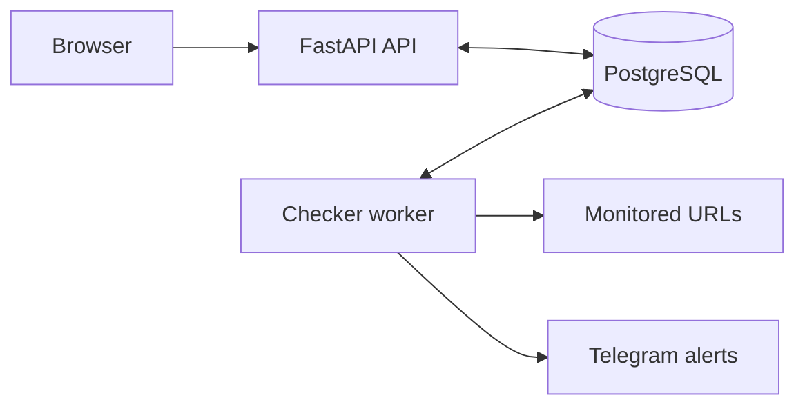
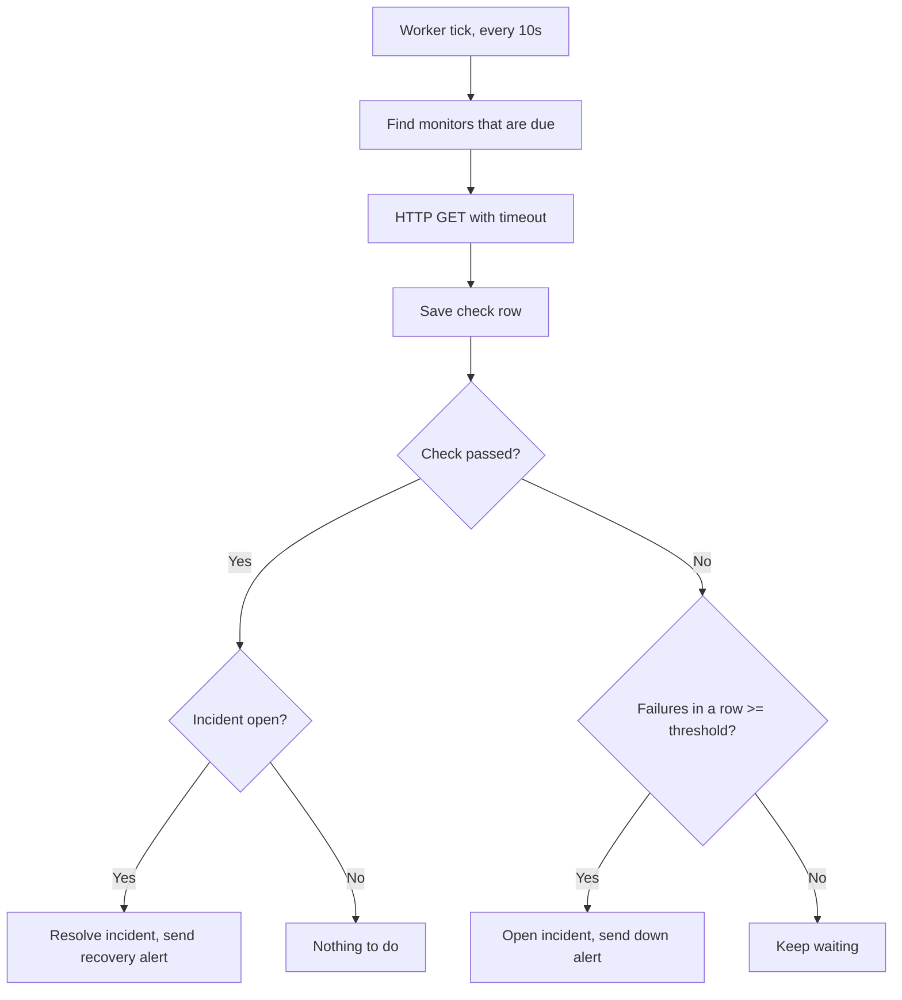
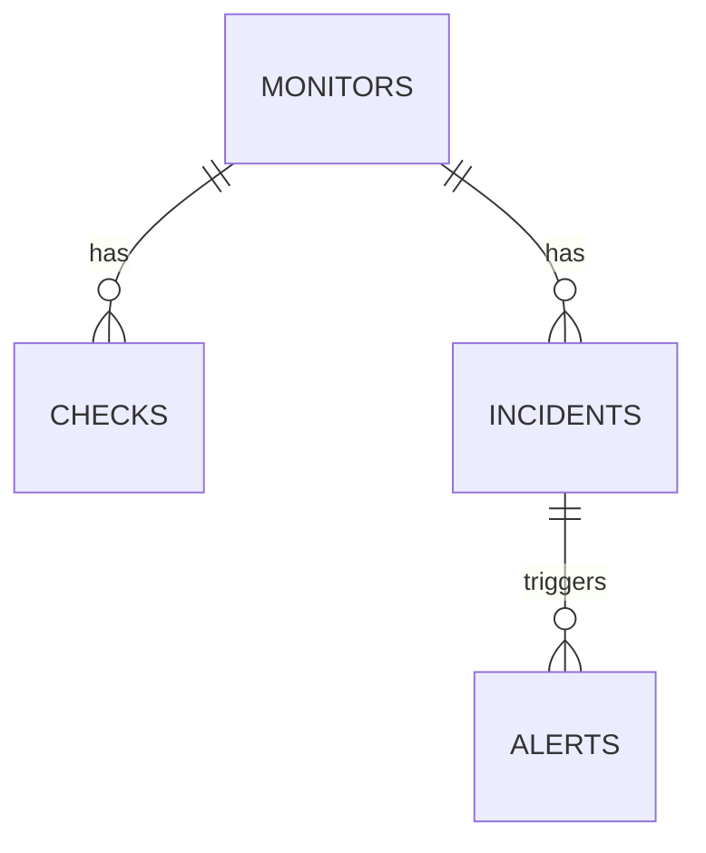

# Vigil

**A self-hosted uptime and incident monitor.** Vigil checks your websites and APIs on a schedule, stores every result in PostgreSQL, opens an incident when a target keeps failing, and sends a Telegram alert when it goes down and when it recovers.

[](https://github.com/Aanushka001/vigil-uptime-monitor/actions/workflows/ci.yml)


<!-- After you run the demo, add a screenshot:  -->

## Why this exists

Small projects and student deployments often learn about an outage from a user instead of from their own tooling. Vigil is a small, readable implementation of the core of an uptime-monitoring system: scheduled checks, consecutive-failure detection, incident tracking, alerting and uptime statistics. It was built as a learning project to practise backend design, SQL, background workers, testing and containerised deployment.

## Features

- Scheduled HTTP checks with per-monitor interval, timeout and failure threshold
- Incident detection: an incident opens only after N consecutive failures, so one slow response does not page you
- Automatic recovery: the incident closes when the target is healthy again
- Telegram alerts for down and recovered events, with delivery status logged
- Uptime percentage, average latency and p95 latency per time window, computed in SQL
- REST API with interactive docs at `/docs`, plus a server-rendered dashboard at `/`
- Write endpoints protected by an API key
- SSRF protection for user-supplied URLs
- Test suite that runs against a real PostgreSQL database in CI

## Architecture



The API and the worker never call each other. They communicate only through the database, which keeps each part small and independently testable.

### One check cycle



The incident rules live in one pure function, `app/services/decision.py`, which has no database or network access and is unit-tested branch by branch.

### Data model



Two database-level guarantees matter:

- `idx_checks_monitor_time` on `(monitor_id, checked_at DESC)` serves the "latest N checks" and "last 24 hours" queries.
- `one_open_incident_per_monitor` is a partial unique index (`WHERE resolved_at IS NULL`). Even if the application code is wrong or two workers race, the database refuses a second open incident for the same monitor.

The full schema is in [`sql/schema.sql`](sql/schema.sql).

## Quick start (Docker)

Requirements: Docker with Compose.

```bash
git clone https://github.com/Aanushka001/vigil-uptime-monitor.git
cd vigil-uptime-monitor
cp .env.example .env        # then edit the passwords and API key
docker compose up --build
```

- Dashboard: http://localhost:8000
- API docs: http://localhost:8000/docs

The database schema is applied automatically the first time the database volume is created. To reset everything: `docker compose down -v`.

## Try the incident demo

`.env.example` enables a demo endpoint (`/demo/flaky`) that you can switch on and off. Replace `YOUR_API_KEY` with the `API_KEY` from your `.env`.

```bash
# 1. Create a monitor for the demo endpoint (checks every 10s, incident after 2 failures)
curl -X POST http://localhost:8000/monitors \
  -H "X-API-Key: YOUR_API_KEY" -H "Content-Type: application/json" \
  -d '{"name":"Demo flaky","url":"http://api:8000/demo/flaky","interval_seconds":10,"failure_threshold":2}'

# 2. Break it, wait about 30 seconds, then open the dashboard: an incident appears
curl -X POST http://localhost:8000/demo/flaky/down -H "X-API-Key: YOUR_API_KEY"

# 3. Fix it, wait about 15 seconds: the incident resolves
curl -X POST http://localhost:8000/demo/flaky/up -H "X-API-Key: YOUR_API_KEY"
```

Inside Docker the worker reaches the API container at `http://api:8000`. To monitor a real site, use its public URL instead.

## Telegram alerts

1. In Telegram, message `@BotFather`, send `/newbot`, and copy the bot token.
2. Send any message to your new bot, then open `https://api.telegram.org/bot<TOKEN>/getUpdates` and copy the `chat` `id`.
3. Put both values in `.env` as `TELEGRAM_BOT_TOKEN` and `TELEGRAM_CHAT_ID`, then run `docker compose up -d`.

Without these values Vigil still works: incidents are recorded and the alert is logged as `delivered = false`.

## Configuration

| Variable | Default | Purpose |
|---|---|---|
| `DATABASE_URL` | local Postgres | SQLAlchemy connection string |
| `API_KEY` | `change-me-api-key` | Required in the `X-API-Key` header for write endpoints |
| `TELEGRAM_BOT_TOKEN` | empty | Bot token for alerts |
| `TELEGRAM_CHAT_ID` | empty | Chat that receives alerts |
| `WORKER_TICK_SECONDS` | `10` | How often the worker looks for due monitors |
| `WORKER_THREADS` | `10` | Parallel checks per tick |
| `ALLOW_PRIVATE_TARGETS` | `false` | Allow private and loopback targets. Use only for local demos |
| `ENABLE_DEMO_ENDPOINTS` | `false` | Expose `/demo/flaky`. Use only for local demos |

## API reference

| Method | Path | Auth | Description |
|---|---|---|---|
| `POST` | `/monitors` | API key | Create a monitor |
| `GET` | `/monitors` | none | List monitors |
| `GET` | `/monitors/{id}` | none | Get one monitor |
| `PATCH` | `/monitors/{id}` | API key | Edit or pause a monitor |
| `DELETE` | `/monitors/{id}` | API key | Delete a monitor and its history |
| `GET` | `/monitors/{id}/checks?limit=50` | none | Recent check results |
| `GET` | `/monitors/{id}/stats?window=24h` | none | Uptime and latency (`1h`, `24h`, `7d`, `30d`) |
| `GET` | `/incidents?status=open` | none | Incidents (`open`, `resolved`, `all`) |
| `GET` | `/health` | none | API and database liveness |
| `GET` | `/` | none | HTML dashboard |

## Security notes

Vigil requests URLs supplied by users, so it guards against server-side request forgery (SSRF):

- Only `http` and `https` URLs are accepted.
- Hostnames are resolved and rejected if they point to private, loopback, link-local, reserved or multicast addresses. The worker re-checks before every request.
- Redirects are not followed, so a redirect cannot send a request to an unvalidated address. Status codes below 400 count as up.
- Response bodies are never downloaded or stored.
- Request URLs are kept out of logs because they can contain secrets, and the API key comparison is constant-time.
- Secrets come from environment variables. `.env` is git-ignored.

## Running tests

Tests need a PostgreSQL database. Start a throwaway one with Docker:

```bash
docker run -d --name vigil-test-db -p 5432:5432 \
  -e POSTGRES_USER=vigil -e POSTGRES_PASSWORD=vigil -e POSTGRES_DB=vigil_test \
  postgres:16-alpine

python -m venv .venv && source .venv/bin/activate      # Windows: .venv\Scripts\activate
pip install -r requirements-dev.txt
pytest -q
```

To use a different database, set `TEST_DATABASE_URL`. The test fixtures drop and recreate Vigil's tables, so never point it at data you care about.

Without a reachable database the integration tests are skipped locally. In CI (`REQUIRE_DB=1`) they fail loudly instead. The suite covers the decision logic, URL validation, the HTTP checker (using a mock transport), the full incident lifecycle, the SQL statistics, the API and the dashboard.

## Project structure

```
vigil-uptime-monitor/
├── app/
│   ├── main.py              FastAPI app, /health and dashboard
│   ├── config.py            Settings from environment variables
│   ├── db.py, models.py     SQLAlchemy engine, session and ORM models
│   ├── schemas.py           Pydantic request and response models
│   ├── security.py          API key dependency
│   ├── worker.py            Polling loop (python -m app.worker)
│   ├── routers/             monitors, incidents, stats, demo
│   ├── services/
│   │   ├── decision.py      Pure incident decision function
│   │   ├── checker.py       HTTP check with timeout and no redirects
│   │   ├── incidents.py     Database side effects for checks and incidents
│   │   ├── alerts.py        Telegram delivery
│   │   ├── stats.py         Uptime and latency SQL
│   │   └── url_safety.py    SSRF guard
│   └── templates/dashboard.html
├── sql/schema.sql           Tables, constraints and indexes
├── tests/
├── Dockerfile, docker-compose.yml
└── .github/workflows/ci.yml
```

## Limitations

- Checks run from a single location, so Vigil cannot tell a regional outage from a global one.
- One worker instance is assumed. Running several would need row locking (`FOR UPDATE SKIP LOCKED`) to avoid duplicate checks.
- Authentication is a single shared API key, not user accounts.
- Only HTTP(S) checks and Telegram alerts are implemented.
- Free hosting tiers generally do not run a background worker, so this project is documented and demonstrated locally with Docker Compose.

## Possible next steps

- Email and Slack alert channels
- Retention policy that aggregates or deletes old check rows
- Row locking for multiple workers
- Keyword and response-time threshold checks
- Authentication with per-user monitors

## License

MIT. See [LICENSE](LICENSE).
